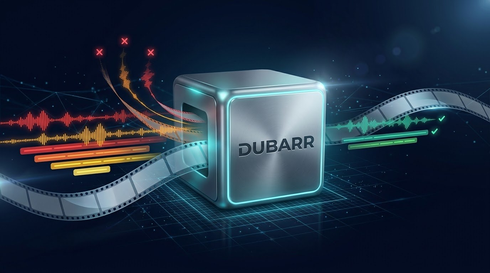

<p align="center"></p>

# Dubarr

Dubarr removes audio and subtitle tracks in languages you don't want from your movies and TV, and flags files that have no audio in your language. Nothing is re-encoded: the video and the tracks you keep are copied bit for bit, so there's no quality loss and no GPU needed.

It's built to be safe to leave running:

- **Report only to start with.** Dubarr lists what it would change and how much space that saves. Nothing changes until you apply it, or turn report-only off.
- **Never guesses.** A file with no audio in your languages is left alone and flagged (*"No English audio, only Korean + Spanish"*). So is a file with an audio track that has no language tag.
- **Swap only after a check.** The cleaned copy is written next to the original and checked (same video, same length, exactly the planned tracks) before it takes the original's place.
- **Recycle folder with restore.** Originals are kept for 7 days (you choose). Restore one file, or a whole batch, from the History page.
- **Waits for seeding.** Hardlinked files, which are usually still seeding, are skipped until the torrent is gone, so a film is never stored twice.
- **Tells everyone.** After a change, Radarr, Sonarr and Jellyfin are asked to rescan the file.

## What it keeps and removes

| The file has | Dubarr |
|---|---|
| Only languages you keep | Leaves it alone |
| Languages you keep, plus others | Removes the others (audio and subtitles, each can be turned off) |
| No audio in a language you keep | Leaves it alone, flags it |
| An audio track with no language tag | Leaves it alone, flags it until you tag it |
| Commentary tracks | Removes them (can be turned off) |

Video, chapters, fonts and anything that isn't audio or subtitles is always kept. Subtitles with no language tag are always kept. Forced subtitles in your languages are kept; forced subtitles in other languages are removed. A "multiple languages" audio track counts as wanted.

**Untagged tracks:** press *Listen & tag* on the Dashboard to hear a 30-second sample of an audio track, or read a few lines of a subtitle track, then choose its language. Dubarr writes the tag into the file (MKV files in place, in a moment), so it isn't flagged again. Picture-based subtitles (Blu-ray PGS) can't be shown as text. Files that are still seeding aren't tagged, as that would change the torrent's data.

Languages are set once for everything, and can be overridden per library, e.g. Japanese + English audio for an anime folder.

MKV files are rewritten with mkvmerge (keeps Dolby Vision, HDR10+, fonts, chapters and tags). MP4 files are rewritten with ffmpeg.

## Install on Unraid

1. Add the template from `unraid/dubarr.xml` (or search Community Apps for Dubarr once it's listed).
2. Map **Movies** and **TV** to your library folders, read/write. Map the same folders Radarr and Sonarr use, so the paths match.
3. Start it, open the web UI (port 9892), and create your login with the setup code from the container's log.
4. Check **Settings > Libraries** and **Settings > General** (languages), then press **Scan now** on the Dashboard.

## Install with Docker

```bash
docker run -d --name dubarr \
  -p 9892:9892 \
  -v /path/to/appdata/dubarr:/config \
  -v /path/to/movies:/movies \
  -v /path/to/tv:/tv \
  ghcr.io/p1zzm1ssile/dubarr:latest
```

Every setting is in the web UI. To pre-fill them on first start, see `.env.tmpl` for the environment variables.

## Radarr, Sonarr and Jellyfin

All optional, under Settings:

- **Rescans:** add the address and API key, and Dubarr asks them to rescan each file it changes.
- **Check new imports straight away:** in Radarr or Sonarr, Settings > Connect > + > Webhook, tick *On Import* and *On Upgrade*, method POST, and paste the address shown on Dubarr's Radarr or Sonarr settings tab. Without it, new files are picked up at the next scheduled scan.
- **Different folders:** if Radarr sees `/data/media/movies` where Dubarr sees `/movies`, set the folder mapping to `/data/media/movies=/movies`.

## Good to know

- **Where originals go:** a hidden `.dubarr-recycle` folder at the top of each library, so moving them is instant on the same disk. You can set your own folder instead; on another disk, moving is a full copy.
- **Restored files are left alone.** After a restore, Dubarr won't strip that file again until you press *Stop leaving alone* on the Dashboard.
- **Array writes:** rewriting a big remux on a parity array takes a while. Set the hours Dubarr may change files (e.g. 1 to 7 overnight) and how many files it changes at a time.
- **Progress:** scans and batches show how far along they are and roughly how long is left. For changes the estimate is based on file sizes, so it settles after the first few files.
- **Interrupted changes are recovered.** If the container stops in the middle of a swap, Dubarr finishes or undoes it on the next start.
- **Forgotten password:** delete `auth.json` from the config folder and restart.
- **Keep it on your home network.** Use a VPN such as WireGuard or Tailscale for remote access, rather than a reverse proxy.

## Development

```bash
pip install -r src/requirements.txt pytest
sudo apt install ffmpeg mkvtoolnix   # the tests make real MKV and MP4 files
python -m pytest tests
cd src && CONFIG_DIR=../config LIBRARIES=/path/to/test/library python main.py
```

## Contact

Bugs and ideas: [open an issue](https://github.com/p1zzm1ssile/Dubarr/issues/new?title=%5BDubarr%5D%20). For anything private, email [p1zzm1ssilerepo@gmail.com](mailto:p1zzm1ssilerepo@gmail.com?subject=Dubarr). Both are also on the Contact page in the web UI.
